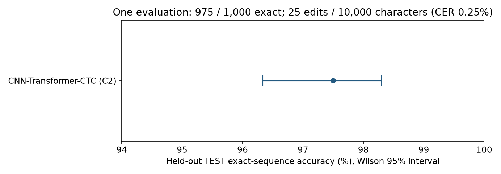
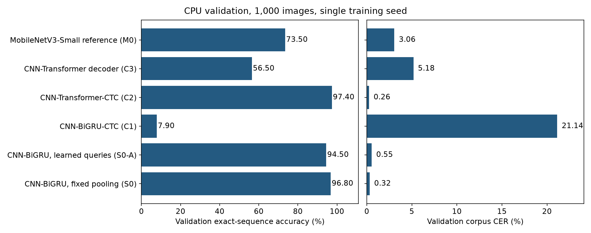

# Complete-image CAPTCHA OCR

Six OCR architectures compared on Aadhav Vignesh's public CAPTCHA Images dataset (10,000 images, 282x90, ten case-sensitive alphanumeric characters each). Every model reads the whole image with no character crops and no resizing. This is not a benchmark of arbitrary CAPTCHA systems.

**Approach.** Five models share one 5-block CNN encoder that keeps the width axis (70 tokens x 256 channels) and differ in the head: BiGRU with positional classifiers (two variants), BiGRU with CTC, Transformer encoder with CTC, and an autoregressive Transformer decoder. A MobileNetV3-Small reference (random init, its own backbone) is included.

**Principal result.** The final model, CNN-Transformer-CTC (C2), got **975/1,000 exact-sequence matches (97.5%) on a held-out TEST partition, with 25 character edits over 10,000 reference characters (0.25% corpus CER)**. Wilson 95% interval for the exact-sequence rate: 96.34%-98.30%. TEST was evaluated once, for C2 only, after the pipeline was frozen.

**Key limitations.** One dataset, one training seed. The TEST result came from a private pipeline and checkpoint that are not distributed, so it cannot be re-run from this repository. C2's validation lead over the CNN-BiGRU baseline is not statistically established. `captcha-ocr train` saves the final epoch, not the validation-selected checkpoint behind the reported numbers. The license is reserved rights (see below).


*Five recognizers share one CNN encoder and differ in their heads; the MobileNetV3-Small reference has a separate backbone. Green marks the final model.*

## Metrics

- **Exact-sequence accuracy:** all ten characters correct, case-sensitive. An empty or wrong-length output counts as wrong.
- **Corpus CER:** total Levenshtein edits divided by total reference characters. Character-level; not sequence accuracy.
- **VAL:** the 1,000-image validation partition used to compare models and select checkpoints. VAL scores are optimistic.
- **TEST:** 1,000 images, evaluated once for C2. Nothing was tuned afterwards.

Earlier CNN/ensemble numbers from a previous project iteration are not part of these results and are not comparable.



*Held-out TEST exact-sequence accuracy for C2 with its Wilson 95% interval.*

## Model comparison (VAL, CPU)

| Architecture (config name) | Exact /1000 | Corpus CER |
|---|---:|---:|
| CNN-Transformer encoder-CTC (C2) | **974** | **0.26%** |
| CNN-BiGRU, fixed pooling (S0) | 968 | 0.32% |
| CNN-BiGRU, learned-query attention (S0-A) | 945 | 0.55% |
| CNN-Transformer decoder, autoregressive (C3) | 565 | 5.18% |
| CNN-BiGRU-CTC (C1) | 79 | 21.14% |
| MobileNetV3-Small reference, random init (M0) | 735 | 3.06% |



*Validation exact-sequence accuracy and corpus CER per architecture (CPU, single seed).*

C2 was selected because it had the highest observed VAL point estimate (not chosen in advance). Its +0.6 point margin over S0 has a paired 95% bootstrap interval of [-0.6, +1.8] points, which crosses zero; superiority is not established. S0 was the baseline throughout. These are specific implementations and schedules, not rankings of model families. The names in parentheses are the `--family` values and `configs/*.json` file names.

## Architecture details

| Name | Head on the shared CNN tokens |
|---|---|
| S0 | Fixed pooling of 70 tokens to 10 positions, 2-layer BiGRU, ten independent 62-way classifiers (positional classification, not CTC) |
| S0-A | Ten learned queries with 4-head attention over the tokens, BiGRU, ten 62-way classifiers |
| C1 | 2-layer BiGRU over 70 tokens, CTC (blank index 62), greedy decoding |
| C2 | Sinusoidal positions, 2 Transformer encoder layers, CTC (blank index 62), greedy decoding |
| C3 | 2-layer causal Transformer decoder with cross-attention, autoregressive, at most 11 emissions |
| M0 | torchvision MobileNetV3-Small, random init, no pretrained weights, 10 pooled positions |

See [architectures](docs/architectures.md).

## Statistical limitations

- The Wilson interval (TEST) and the paired bootstrap (C2 vs S0, interventions; 2,000 resamples, seed 42) quantify **example-level** sampling uncertainty on a fixed 1,000-image partition for a fixed trained checkpoint.
- They do **not** capture training-seed variance. Every model was trained with a single seed, so seed robustness is unknown.
- One dataset; no external or cross-generator evaluation. No confidence calibration analysis (no reliability curves or abstention) was performed.
- Three single-seed interventions on S0 were measured (learned-query alignment and contrast treatment: negative; class-weighted loss: neutral). An augmentation intervention was planned but never run, so no augmentation effect is known.
- CPU and GPU runs differed slightly for the class-weighted S0 run (970 vs 969 exact) and C1 (2118 vs 2114 edits), cause unknown; CPU numbers are reported.

See [limitations](docs/limitations.md) and [data split and duplicate handling](docs/split-and-duplicates.md).

## Selection procedure and training checkpoints

Models were trained with seed 42, Adam (lr 1e-3, cosine to 1e-5), batch 32, 25 epochs, gradient clip 5. Checkpoints were chosen by highest VAL exact count, then lowest CER, then earliest epoch. C2 was chosen among models by highest VAL exact-sequence accuracy.

**The `captcha-ocr train` command saves the final epoch and performs no VAL selection.** Its output is therefore not equivalent to the checkpoints behind the reported numbers, and byte-identical retraining is not promised. See [checkpoint workflows](docs/checkpoint-workflows.md).

## Install and CPU inference (Python 3.12)

Runnable without any data or checkpoint:

```sh
python3 -m venv .venv
.venv/bin/pip install torch==2.8.0 torchvision==0.23.0 --index-url https://download.pytorch.org/whl/cpu
.venv/bin/pip install -e .
.venv/bin/python -m unittest discover -s tests -v
.venv/bin/captcha-ocr --help
```

Needs a local checkpoint or your own dataset copy (none is distributed). `train` is runnable on your own TRAIN manifest but is not the procedure behind the reported checkpoints:

```sh
captcha-ocr predict --family C2 --checkpoint CHECKPOINT --image IMAGE --output predictions.json
captcha-ocr predict --family C2 --checkpoint CHECKPOINT --image IMAGE1 IMAGE2 --device cuda --output batch.json
captcha-ocr evaluate --family C2 --checkpoint CHECKPOINT --manifest VAL_MANIFEST --expected-manifest-sha256 VAL_SHA256 --output validation.json
captcha-ocr train --family S0 --manifest TRAIN_MANIFEST --epochs 25 --seed 42 --output checkpoint.pt
```

Uppercase arguments are your own local files; `--family` takes the config names above. Inference is CPU by default (reference protocol: one thread, batch 1, about 20 ms per image for C2); `--device cuda` fails if CUDA is unavailable and `--device auto` reports the device used. See [deployment](docs/deployment.md). CI configuration exists in `.github/workflows/tests.yml` but **has never run on hosted infrastructure** (no remote); tests were run locally on CPU.

## Data and weights availability

Not shipped: CAPTCHA images, the dataset archive, label-bearing manifests, exact split membership/fingerprints (`configs/development_splits.json`), trained checkpoints, TEST labels and predictions. The fingerprint collection is excluded pending metadata-rights clearance; accepted internal source/history is unchanged. Obtain any dataset separately ([dataset setup](docs/dataset.md); the publisher declares CC BY-NC-SA 4.0). Exact reported partitions and artifacts cannot be reconstructed from this export alone. The following commands require independently authorized local frozen TRAIN/VAL fingerprints; preparation matches supplied membership, never generates a new split:

```sh
python -m captcha_ocr.prepare --images ACQUIRED_IMAGES --splits AUTHORIZED_LOCAL_SPLITS.json --output LOCAL_MANIFESTS
python -m captcha_ocr.validate --manifest VAL_MANIFEST --split validation --expected-sha256 LOCAL_VAL_SHA256 --splits AUTHORIZED_LOCAL_SPLITS.json
```

The CLI and split tools accept TRAIN/VAL manifests only; the TEST path check is a hygiene guard (substring match), not a security control.

## Repository structure

```text
src/captcha_ocr/   models, metrics, CLI, device handling, split tools
configs/           per-model preprocessing descriptions (file name = model name); exact split fingerprints excluded
tests/             dataset-independent software checks (14 tests)
scripts/           figure rendering (`pip install '.[figures]'`)
docs/              methodology, results, reproduction, rights, limitations
assets/figures/    architecture diagram, aggregate charts (no CAPTCHA imagery), results.json
```

Supporting docs: [methodology](docs/methodology.md), [results](docs/results.md), [ablations](docs/ablations.md), [experiments](docs/experiments.md), [figures](docs/figures.md), [release provenance](docs/release.md), [reproducibility](docs/reproducibility.md), [rights inventory](docs/rights-inventory.md).

## License and rights

**This repository is not open source.** The [LICENSE](LICENSE) reserves rights; no general public reuse grant is selected. Nguyen Quang Huy's source-publication authority is confirmed by OWNER_ATTESTATION (2026-10-27), not independent ownership verification. Public visibility does not grant general reuse rights; obtain permission beyond applicable statutory exceptions and hosting-platform terms. The owner has not chosen a permissive license ([notes](docs/license-decision.md)). Dataset rights (CC BY-NC-SA 4.0 as declared by the publisher), PyTorch/torchvision licenses and checkpoints remain separate. Dataset/checkpoint redistribution is uncleared. See [rights inventory](docs/rights-inventory.md).
