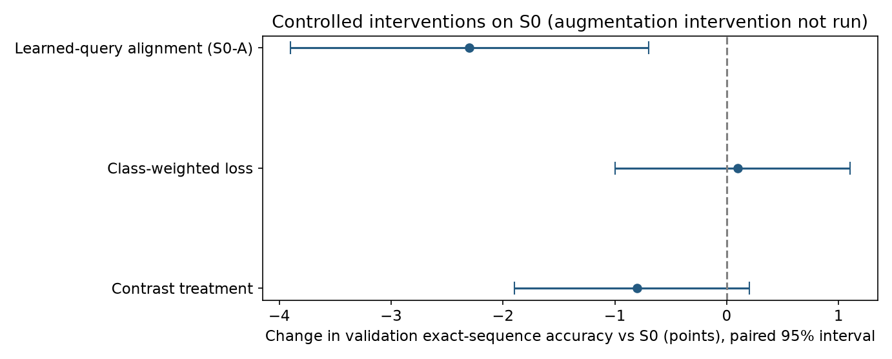

# Controlled interventions

| Intervention (S0 plus) | CPU exact /1,000 | Exact-sequence difference vs S0 | Paired 95% interval |
|---|---:|---:|---:|
| Learned-query alignment (this is S0-A) | 945 | -2.3 percentage points | [-3.9,-0.7] |
| Class-weighted loss | 969 | +0.1 percentage points | [-1.0,+1.1] |
| Contrast treatment | 960 | -0.8 percentage points | [-1.9,+0.2] |

The class-weighted CER difference is zero on CPU. A GPU run gave 970 exact; the CPU 969 is reported. Weighting produced no demonstrated meaningful benefit; negative outcomes remain visible.

**An augmentation intervention was planned but not run.** No checkpoint or measured effect exists; this is neither a positive nor a negative result.

These are matched S0 interventions. Broader architecture comparisons change multiple modeling assumptions and are not single-factor causal ablations.
