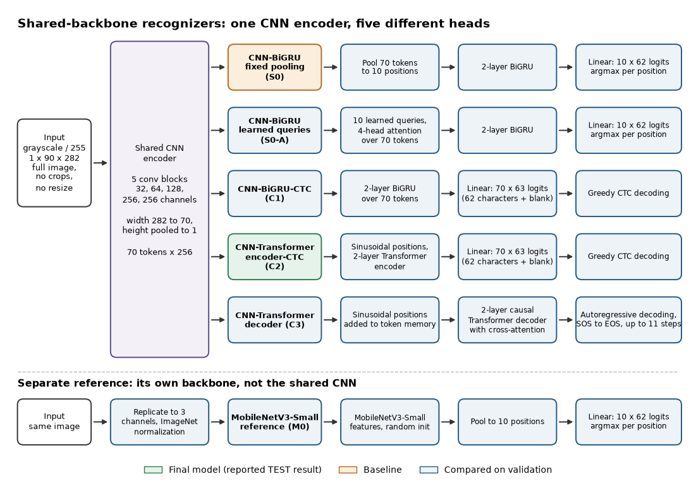

# Architectures

*Five recognizers share one CNN encoder; the MobileNetV3-Small reference has its own backbone. Regenerate with `scripts/render_figures.py`.*

Config names (used by `--family` and `configs/*.json`) map to readable names:

| Config name | Readable name | Role |
|---|---|---|
| C2 | CNN-Transformer encoder-CTC | Final model (the only model evaluated on TEST) |
| S0 | CNN-BiGRU, fixed pooling | Baseline for comparisons and controlled interventions |
| S0-A | CNN-BiGRU, learned-query attention | Compared on validation |
| C1 | CNN-BiGRU-CTC | Compared on validation |
| C3 | CNN-Transformer decoder (autoregressive) | Compared on validation |
| M0 | MobileNetV3-Small reference | Compared on validation; separate backbone, random init |

C2 was picked because it had the highest observed VAL result, not in advance; its margin over S0 is within uncertainty (see [results](results.md)).

## Shared encoder (S0, S0-A, C1, C2, C3)

Input: full 282x90 grayscale image, scaled to [0, 1], no crops and no resize. Five conv-BN-ReLU blocks with 32, 64, 128, 256 and 256 channels. Max-pooling halves width twice (282 to 141 to 70) and height is reduced to 1, giving 70 width tokens of 256 channels (`spatial_models.py`).

## Heads

| Model | Head | Output and decoding |
|---|---|---|
| S0 | Fixed mean pooling of 70 tokens to 10 positions, 2-layer BiGRU (128 per direction) | 10 x 62 logits, independent argmax per position (positional classification, no CTC) |
| S0-A | Ten learned queries, 4-head attention over the tokens (sinusoidal positions on keys), then the same BiGRU | 10 x 62 logits, argmax per position |
| C1 | 2-layer BiGRU over the 70 tokens | 70 x 63 logits (62 characters + blank index 62), greedy CTC |
| C2 | Sinusoidal positions, 2 Transformer encoder layers (dimension 256, 4 heads, feed-forward 512, dropout 0.1) | 70 x 63 logits, greedy CTC |
| C3 | Sinusoidal positions on the tokens as memory; 2-layer causal Transformer decoder with cross-attention | Autoregressive: SOS index 62, EOS index 63, at most 11 emissions; previous tokens are the model's own outputs at inference. Custom decoder, not PARSeq or SAR |
| M0 | torchvision MobileNetV3-Small features (not the shared CNN), pooled to 10 positions, linear head | 10 x 62 logits, argmax per position. Grayscale replicated to 3 channels with ImageNet normalization, random init, no pretrained weights |

CTC decoding collapses consecutive repeated tokens before removing the blank. A blank between repeated characters lets both survive. Model state structures match the existing checkpoints.
